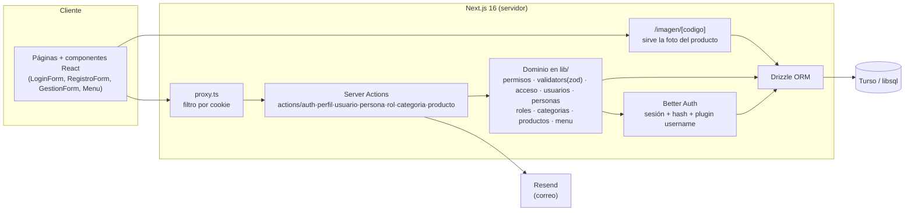
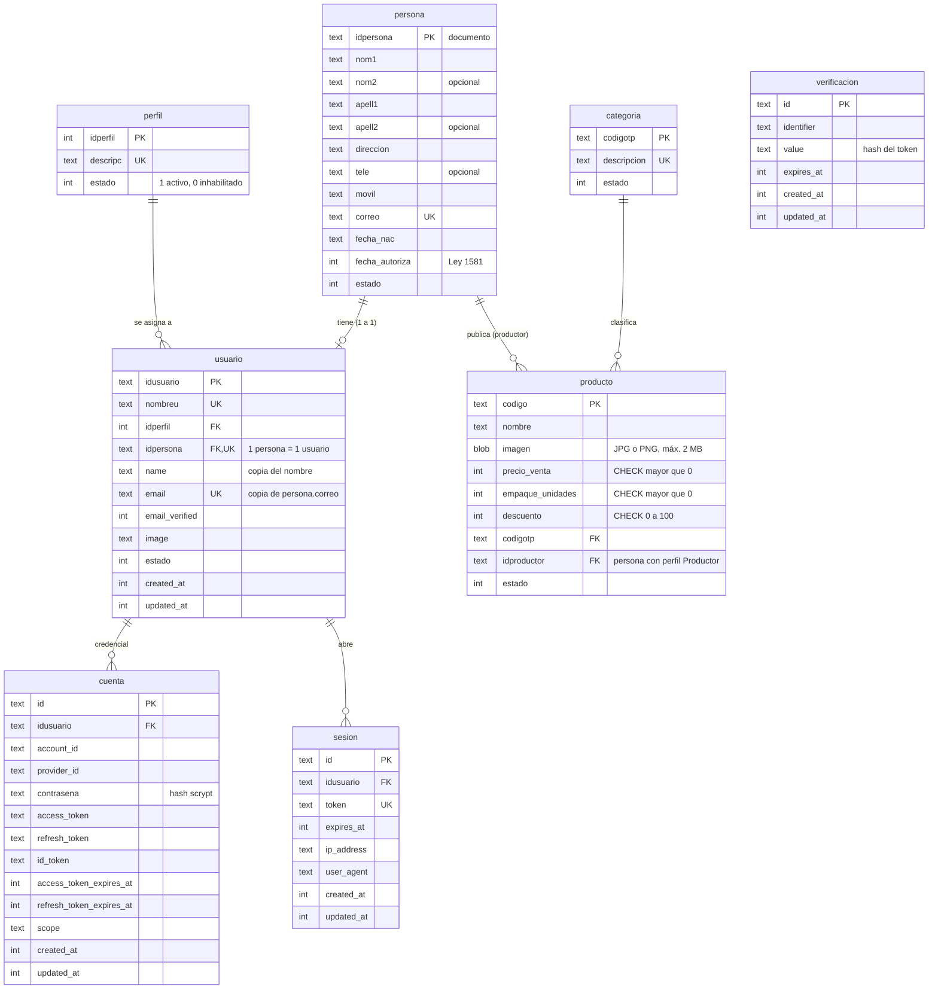
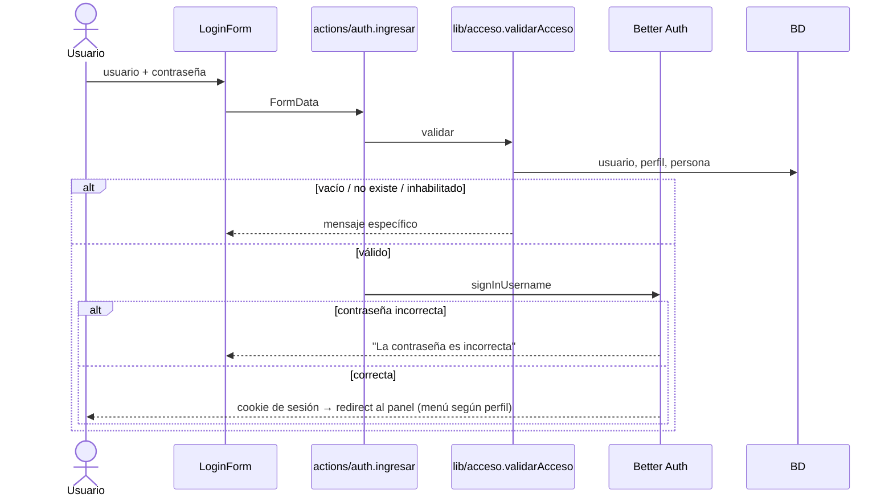
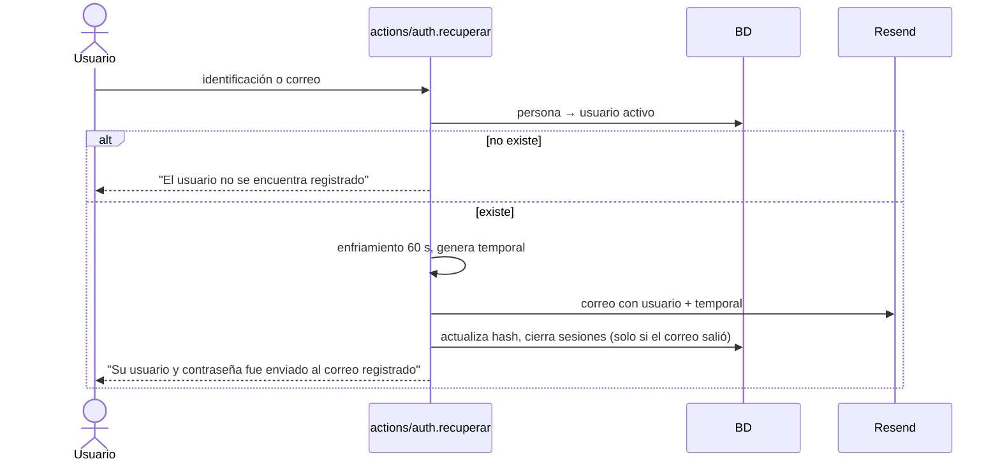

# Arquitectura · Medialuna (Parcial I + Parcial II)

Alcance:
- **Parcial I**: acceso al sistema, menú y CRUD de **Perfil**, **Usuario** y **Persona** con borrado lógico.
- **Parcial II** (requisitos aprobados HU-01 a HU-04): gestión de **Productores**, **Compradores**, **Categorías** y **Productos**, y el **Catálogo**.

Pedidos, calificaciones y el agente de WhatsApp quedan para el Final; ver [Qué no entra todavía](#qué-no-entra-todavía).

## Estilo: monolito modular en capas (Next.js App Router)

Un solo despliegue. La UI nunca toca la BD: todo pasa por *Server Actions* que validan sesión, permiso y datos. Es la arquitectura mínima adecuada para un MVP de CRUD con autenticación; se separa en capas para poder extraerla luego (p. ej. el agente de WhatsApp como servicio aparte).

| Capa | Responsabilidad | Ubicación |
|---|---|---|
| Presentación | Formularios, tabla, mensajes; sin lógica de negocio | `src/app`, `src/components` |
| Aplicación | Autoriza (`exigir`), valida, orquesta y traduce errores a mensajes | `src/actions` |
| Dominio | Matriz de permisos, validaciones, reglas de acceso, de usuarios y del mercado | `src/lib` |
| Infraestructura | Esquema, cliente BD, migraciones, correo | `src/db`, `drizzle/`, `src/lib/mail.ts` |

Un solo componente, `GestionForm`, pinta todas las gestiones (Crear, Consultar, Modificar, Inhabilitar, Guardar, Salir): cada página le entrega sus campos, columnas, acciones y permisos. Por eso todas se ven y se comportan igual.

## Modelo de datos

`perfil`, `persona` y `usuario` son el modelo del Parcial I; `categoria` y `producto` son las tablas nuevas del Parcial II; `cuenta`, `sesion` y `verificacion` las exige Better Auth (su tabla `user` **es** `usuario`, mapeada por nombre de columna). `verificacion` no tiene llave foránea: guarda tokens de un solo uso identificados por el correo.

### Tercera forma normal

- **1FN**: cada columna guarda un solo valor (nombres y apellidos separados, un teléfono por columna, sin listas ni grupos repetidos) y toda tabla tiene llave primaria.
- **2FN**: todas las llaves primarias son de una sola columna, así que ningún atributo puede depender de «parte» de una llave.
- **3FN**: ningún atributo depende de otro que no sea llave. `producto` guarda `codigotp` y no la descripción de la categoría; guarda `idproductor` y no el nombre del productor; `usuario` guarda `idperfil` y no la descripción del perfil. El **precio final no se guarda**: se calcula (`precio_venta × (100 − descuento) / 100`, `lib/productos.ts`), porque guardarlo lo haría depender de otras dos columnas.

Única redundancia, y es deliberada: `usuario.email` y `usuario.name` copian datos de `persona` porque Better Auth los exige en su tabla de usuarios. No rompe la 3FN (dependen de `idpersona`, que es llave candidata de `usuario` por ser `UNIQUE`), y `modificarPersona` las actualiza en la misma operación para que no se desalineen.

### Decisiones de datos

- **Borrado lógico**: Inhabilitar es `UPDATE estado = 0`; no existe ningún `DELETE` sobre las tablas del negocio. Una sesión deja de ser válida si usuario, perfil o persona están inhabilitados (se relee la BD en cada petición).
- **Contraseña**: `usuario.contrasena` del diagrama del parcial se guarda **hasheada** en `cuenta.contrasena` (Better Auth). Nunca en claro.
- **1:1**: `usuario.idpersona` es `UNIQUE`; `crearUsuario` además lo valida con mensaje claro.
- **Productor y Comprador no tienen tabla propia**: son una `persona` cuyo `usuario` tiene perfil Productor (2) o Comprador (3). Sus datos (documento, nombres, celular, dirección, correo, fecha de nacimiento) ya son columnas de `persona`; una tabla `productor` o `comprador` solo repetiría la llave. Su estado es `usuario.estado`: inhabilitarlos les impide ingresar sin borrar nada.
- **Imagen del producto en la base** (`producto.imagen`, blob): el disco de Vercel no es persistente, así que un archivo subido se perdería en el siguiente despliegue. Se sirve por `/imagen/[codigo]` y el tipo (JPG/PNG) se comprueba por la firma del archivo, no por su extensión.
- **Reglas en la base además de en el código**: `CHECK` de precio, empaque y descuento; `UNIQUE` de descripción de categoría, correo y usuario.

## Acceso al sistema

## Recuperación de usuario y contraseña

El hash no es reversible, por lo que no se puede reenviar la contraseña actual: se envía el **usuario** y una **contraseña temporal** nueva, con la que se ingresa y luego se cambia en «Mi contraseña».

Sin `RESEND_API_KEY` el correo se imprime en consola (solo desarrollo).

## Permisos y menú

Se aplican **en servidor** (`exigir` en cada action, `exigirPagina` en cada página); ocultar botones es solo UX. La matriz vive en `lib/permisos.ts` y de ella salen tanto la validación como los botones y el menú (`lib/menu.ts`), así que no pueden contradecirse.

| Gestión | Crear | Consultar | Modificar | Inhabilitar |
|---|:-:|:-:|:-:|:-:|
| Perfil | Admin | Admin | Admin | Admin |
| Usuario | Admin | Admin | Admin | Admin |
| Persona | Admin** | Admin | Admin | Admin |
| Productores (HU-01) | Admin | Admin | Admin | Admin |
| Compradores (HU-02) | Admin** | Admin | Admin | Admin |
| Categorías (HU-03) | Admin | Admin | Admin | Admin |
| Productos (HU-04) | Productor | Admin y Productor | Productor | Admin y Productor |

Guardar es el envío de Crear/Modificar y Salir es navegación: no son permisos propios.

\*\* Además, cualquier persona se registra sola como comprador en `/registro` (sin sesión).

| Perfil | Opciones del menú |
|---|---|
| Administrador | Panel · Gestión Perfil, Usuario, Persona, Productores, Compradores, Categorías y Productos · Catálogo · Mi contraseña |
| Productor | Panel · Mis productos · Catálogo · Mis datos · Mi contraseña |
| Comprador | Panel · Catálogo · Mis datos · Mi contraseña |

- **Productos**: el productor ve y gestiona **solo los suyos** (la propiedad se valida en `lib/productos.ts`, no basta con ocultarlos). El administrador consulta todos y puede inhabilitar los que incumplan las políticas, pero no los crea ni los modifica.
- **Mis datos** (`/mis-datos`): productor y comprador actualizan sus propios datos; el documento no se puede cambiar.
- **Catálogo** (`/catalogo`): solo muestra productos activos, de categoría activa y de productor activo; se filtra por nombre, categoría y productor.

**Perfiles del sistema.** Administrador (1), Productor (2) y Comprador (3) se siembran y el código depende de su id (`lib/permisos.ts`), así que no se pueden modificar ni inhabilitar: renombrarlos cambiaría su significado sin cambiar sus reglas, inhabilitar Comprador rompería el registro e inhabilitar Productor dejaría fuera a todos los productores. El CRUD completo aplica a los perfiles nuevos, que no tienen acceso a ninguna gestión; Gestión Perfil muestra el alcance de cada uno.

## Validaciones

La fuente de verdad es el servidor (`lib/validators.ts`, zod): los formularios llevan `noValidate` y cada error vuelve **junto a su campo** («Campo requerido», «Solo se permiten números», «El productor debe ser mayor de 18 años», «El descuento debe estar entre 0 y 100»…). En el navegador solo se adelanta lo que mejora la escritura: cédula, celular, precio, empaque y descuento descartan cualquier carácter que no sea dígito, y la imagen se revisa (tipo y 2 MB) antes de subirla.

**Información dependiente.** No se puede inhabilitar un registro del que dependen otros activos; el mensaje dice de cuáles:

| Se intenta inhabilitar | Se bloquea si… | Mensaje |
|---|---|---|
| Perfil | tiene usuarios activos | `No se puede inhabilitar el perfil: existe información dependiente (N usuarios activos lo tienen asignado)` |
| Persona | su usuario está activo | `No se puede inhabilitar la persona: existe información dependiente (su usuario «x» está activo; inhabilítelo primero)` |
| Categoría | tiene productos activos | `No se puede inhabilitar la categoría: existe información dependiente (N productos activos)` |

Inhabilitar un **productor** sí se permite aunque tenga productos: deja de poder ingresar y sus productos salen del catálogo sin perderse; al habilitarlo vuelven.

## Cuentas: quién se registra y verificación de correo

| Perfil | Alta | Verificación de correo |
|---|---|---|
| Comprador (`idperfil = 3`) | Se registra solo en `/registro` (el servidor fija el perfil) o lo crea el administrador en Gestión Compradores | Opcional: se envía el enlace, pero puede ingresar sin verificar |
| Productor (`idperfil = 2`) | Solo el administrador, en Gestión Productores (crea persona y usuario en un paso) | Obligatoria: con la contraseña correcta, el ingreso se bloquea y se reenvía el enlace. El administrador puede marcarla como hecha en Gestión Usuario («Correo verificado») |
| Administrador (`idperfil = 1`) | Seed | No aplica |

- **Correo confiable** (`lib/verificacion.ts`): se rechazan dominios desechables (lista corta; solo con `DEVELOPMENT_STAGE=FALSE`, por defecto `TRUE` los acepta para pruebas) y dominios sin registro MX o con "null MX". Si el DNS falla por red, se deja pasar.
- **Enlace** `/verificar?token=…`: token aleatorio guardado como hash en `verificacion`, vence en 24 h, un solo uso y atado al correo vigente (cambiar el correo invalida el enlace y desmarca la verificación). Se confirma con un botón (POST) que además registra la autorización Ley 1581 si faltaba.
- **Mi contraseña** (`/contrasena`): cualquier usuario cambia su contraseña; se cierran las demás sesiones y la actual sigue viva.

**Comprar y publicar.** Cada usuario tiene un solo perfil y el Productor incluye al Comprador: el Comprador solo compra; el Productor compra y publica. Así una persona puede hacer ambas cosas con un único usuario, sin tabla `usuario_perfil`: «publicar sin comprar» no tiene sentido en el mercado, así que el muchos-a-muchos solo añadiría combinaciones inútiles y se apartaría del modelo del parcial. Un comprador que quiera vender lo pasa a Productor el administrador en Gestión Usuario, y desde ese momento debe verificar su correo para ingresar. El Administrador es un perfil de gestión: no compra ni publica.

## Qué no entra todavía

- **Correo obligatorio para el productor.** HU-01 lo marca opcional, pero en Medialuna el correo es la credencial de recuperación y el medio de verificación del productor, y es único en `persona` y `usuario`. Se mantiene obligatorio.
- **Reglas que dependen de pedidos** (HU-01 y HU-02): impedir inhabilitar a quien tenga pedidos en curso y mostrar el número de pedidos. La tabla de pedidos llega en el Final; hasta entonces esas reglas no existen y no deben presentarse como hechas.

## Despliegue y configuración

Variables en `.env.example`. Local: `file:local.db` (mismo driver libsql); producción: `TURSO_DATABASE_URL` + `TURSO_AUTH_TOKEN`. Migraciones versionadas en `drizzle/` (`pnpm db:migrate`), datos mínimos con `pnpm db:seed`, datos de demostración con `pnpm db:demo` y `pnpm db:ver <tabla>` para ver lo guardado.
