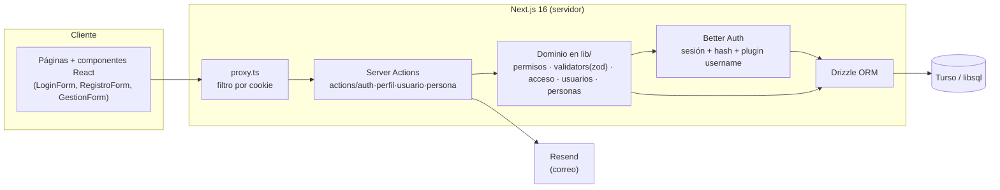
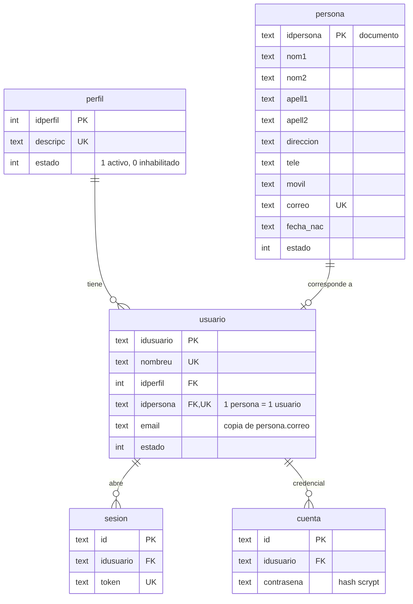
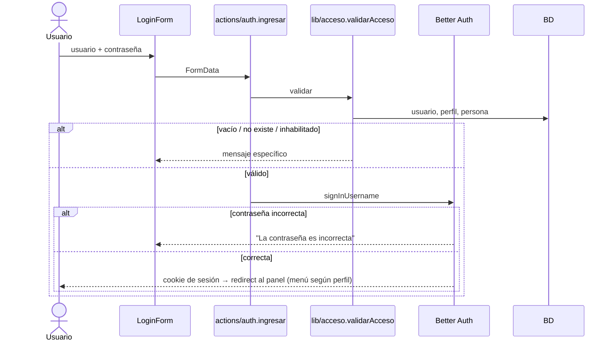
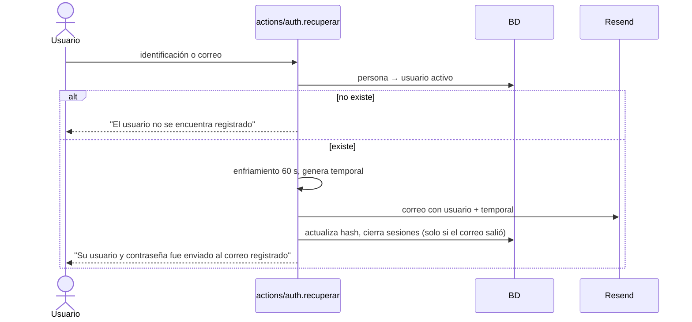

# Arquitectura · Medialuna MVP (Parcial I)

Alcance: Acceso al sistema, menú y CRUD de **Perfil**, **Usuario** y **Persona** con borrado lógico. El tema (mercado campesino digital con agente en WhatsApp) se refleja en el panel; catálogo, pedidos y agente (RF03–RF13 de la propuesta) quedan para etapas posteriores.

## Estilo: monolito modular en capas (Next.js App Router)

Un solo despliegue. La UI nunca toca la BD: todo pasa por *Server Actions* que validan sesión, permiso y datos. Es la arquitectura mínima adecuada para un MVP de CRUD con autenticación; se separa en capas para poder extraerla luego (p. ej. el agente de WhatsApp como servicio aparte).

| Capa | Responsabilidad | Ubicación |
|---|---|---|
| Presentación | Formularios, tabla, mensajes; sin lógica de negocio | `src/app`, `src/components` |
| Aplicación | Autoriza (`exigir`), valida, orquesta y traduce errores a mensajes | `src/actions` |
| Dominio | Matriz de permisos, validaciones, reglas de acceso y de usuarios | `src/lib` |
| Infraestructura | Esquema, cliente BD, migraciones, correo | `src/db`, `drizzle/`, `src/lib/mail.ts` |

## Modelo de datos

El modelo del parcial (`perfil`, `usuario`, `persona`) se respeta con dos diferencias que hay que explicar: la contraseña (hash) vive en `cuenta.contrasena` y no en `usuario`, y `persona.fecha_autoriza` guarda la evidencia de la autorización de datos (Ley 1581, art. 9). Better Auth exige `sesion`, `cuenta` y `verificacion`; su tabla `user` **es** `usuario` (mapeada por nombre de columna), con `idperfil`, `idpersona` y `estado` como campos adicionales, y `email_verified` para la verificación de correo.

Decisiones de datos:
- **Borrado lógico**: Inhabilitar es `UPDATE estado = 0`; no existe ningún `DELETE` sobre perfil/usuario/persona. Una sesión deja de ser válida si usuario, perfil o persona están inhabilitados (se relee la BD en cada petición).
- **Contraseña**: `usuario.contrasena` del diagrama del parcial se guarda **hasheada** en `cuenta.contrasena` (Better Auth). Nunca en claro.
- **1:1**: `usuario.idpersona` es `UNIQUE`; `crearUsuario` además lo valida con mensaje claro.

## Acceso al sistema

## Recuperación de usuario y contraseña

El hash no es reversible, por lo que no se puede reenviar la contraseña actual: se envía el **usuario** y una **contraseña temporal** nueva.

Sin `RESEND_API_KEY` el correo se imprime en consola (solo desarrollo).

## Permisos (matriz del parcial)

Se aplican **en servidor** (`exigir` en cada action, `exigirPagina` en cada página); ocultar botones es solo UX.

| Gestión | Crear | Consultar | Modificar | Inhabilitar |
|---|:-:|:-:|:-:|:-:|
| Perfil | Admin | Admin | Admin | Admin |
| Usuario | Admin | Admin | Admin | Admin |
| Persona | Admin** | Todos* | Todos* | Admin |

Guardar es el envío de Crear/Modificar y Salir es navegación: no son permisos propios.

\* Un perfil no administrador solo ve y modifica **su propia** persona.

**Perfiles del sistema.** Administrador (1), Productor (2) y Comprador (3) se siembran y el código depende de su id (`lib/permisos.ts`), así que no se pueden modificar ni inhabilitar: renombrarlos cambiaría su significado sin cambiar sus reglas, inhabilitar Comprador rompería el registro e inhabilitar Productor dejaría fuera a todos los productores. El CRUD completo aplica a los perfiles nuevos, que reciben los permisos de persona (consultar y modificar sus propios datos); Gestión Perfil muestra el alcance de cada uno.

\*\* El "Crear persona" del actor Persona en la tabla del parcial es el **autorregistro** (botón Registrarse → `/registro`, sin sesión), no dar de alta a terceros con sesión.

## Cuentas: quién se registra y verificación de correo

| Perfil | Alta | Verificación de correo |
|---|---|---|
| Comprador (`idperfil = 3`) | Se registra solo en `/registro` (el servidor fija el perfil) | Opcional: se envía el enlace, pero puede ingresar sin verificar |
| Productor (`idperfil = 2`) | Solo el administrador (Gestión Persona + Gestión Usuario) | Obligatoria: con la contraseña correcta, el ingreso se bloquea y se reenvía el enlace. El administrador puede marcarla como hecha en Gestión Usuario («Correo verificado») |
| Administrador (`idperfil = 1`) | Seed | No aplica |

- **Correo confiable** (`lib/verificacion.ts`): se rechazan dominios desechables (lista corta) y dominios sin registro MX o con "null MX". Si el DNS falla por red, se deja pasar.
- **Enlace** `/verificar?token=…`: token aleatorio guardado como hash en `verificacion`, vence en 24 h, un solo uso y atado al correo vigente (cambiar el correo invalida el enlace y desmarca la verificación). Se confirma con un botón (POST) que además registra la autorización Ley 1581 si faltaba.
- **Mi contraseña** (`/contrasena`): cualquier usuario cambia su contraseña; se cierran las demás sesiones y la actual sigue viva.

## Despliegue y configuración

Variables en `.env.example`. Local: `file:local.db` (mismo driver libsql); producción: `TURSO_DATABASE_URL` + `TURSO_AUTH_TOKEN`. Migraciones versionadas en `drizzle/` (`pnpm db:migrate`), datos mínimos con `pnpm db:seed`.
