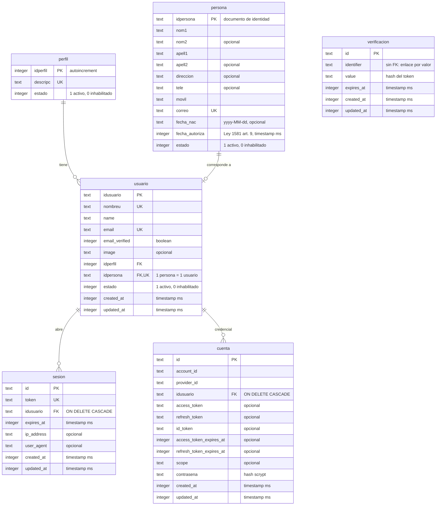

# Modelo de datos · Medialuna

Diagrama relacional completo, derivado de `src/db/schema.ts` (nombres de tabla y columna tal como existen en la BD). Si cambia el esquema, actualizar este archivo junto con `pnpm db:generate`.

Notas:
- `usuario` es la tabla `user` de Better Auth; `sesion`, `cuenta` y `verificacion` también son suyas.
- `verificacion` no tiene clave foránea: se relaciona con el usuario por valor (`identifier` con formato `<tipo>:<idusuario>:<correo>`), por eso aparece aislada.
- Borrado lógico: perfil, persona y usuario se inhabilitan con `estado = 0`; el `ON DELETE CASCADE` solo aplica a `sesion` y `cuenta`.
